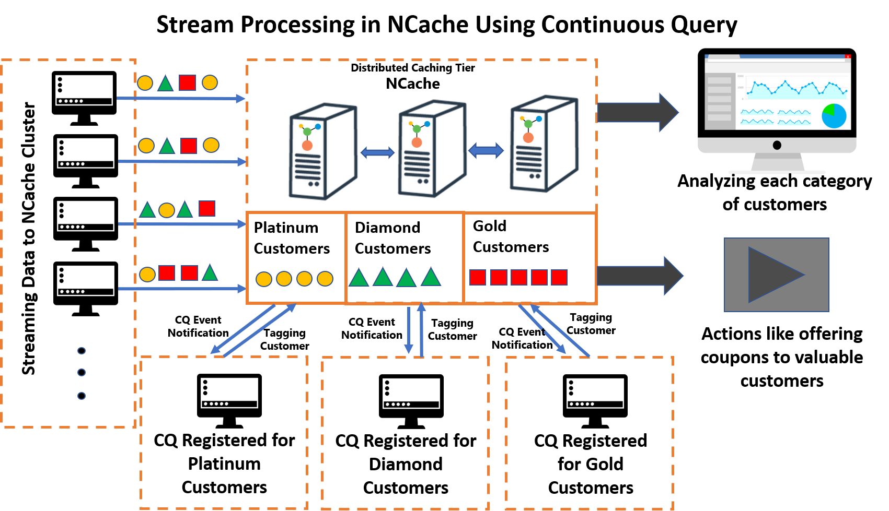

# Stream Processing Using NCache Continuous Query

### Table of contents

* [Introduction](#introduction)
* [Getting Started](#getting-started)
* [Working](#working)
* [Built With](#built-with)
* [Additional Resources](#additional-resources)

## Introduction
This project demonstrates how a stream of data can be processed on NCache server nodes using Continuous Query (CQ). The filtering happens on the cache servers, which push matching items to the client as they arrive, so the client can monitor the data and act on it in real time.

## Getting Started

These instructions will get you a copy of the project up and running on your local machine for development and testing purposes.

### Prerequisites

Following are required before you can run this app:

 - NCache Enterprise (version 5.3)
 - .NET 6.0 SDK and Runtime
 - Visual Studio 2022 (or the `dotnet` CLI)

Note that the app has been tested with NCache SDK `Alachisoft.NCache.SDK` 5.3.800.

### Installing
*Please ensure that the prerequisites are installed before continuing.*

#### Create Cache

A cache needs to be linked with the app. NCache is installed with a cache named `defaultCache`, which this sample uses by default.
If that cache is not available, create a new cache. [Docs](https://www.alachisoft.com/resources/docs/ncache/admin-guide/create-new-cache-cluster.html?tabs=windows)

> **Warning:** on startup, StreamProcessingUI calls `Clear()` on the cache, which removes **all** of its data. Do not point it at a cache that holds data you need.

#### Configure Query Index

Continuous queries filter on `Models.Customer.OrdersCount`, so the cache needs a query index for it:

1. Build the solution.
2. In NCache Management Center, open the cache, go to **Query Indexes** and add `src\Models\bin\Debug\netstandard2.0\Models.dll`.
3. Select the class `Models.Customer` and the attribute `OrdersCount`, then save.

Without this index the continuous queries cannot be registered and the customer counts stay at 0.

#### Link Cache with App

Set the cache name and the cache server in both of the following files. The server and port go in the `ncache` section, which NCache reads itself, so no `client.ncconf` is needed:

1. `src\StreamToNCache\appsettings.json`
1. `src\StreamProcessingUI\appsettings.json`

```json
{
  "CacheName": "defaultCache",
  "ncache": {
    "defaultCache": {
      "server": "{cache server IP}",
      "port": 9800
    }
  }
}
```

- *CacheName*: the name of your cache.
- *ncache*: one entry per cache, keyed by the cache name, with the IP address (`server`) and client port (`port`, default `9800`) of an NCache server hosting the cache.

If *CacheName* is missing, the app stops with a clear error message.

### Starting the App

This solution contains three projects:
1.	**Models** (`netstandard2.0`): shared `Customer` and `Order` classes
2.	**StreamProcessingUI** (`net6.0`): registers the continuous queries and prints the counts
3.	**StreamToNCache** (`net6.0`): streams fake customers into the cache

Build the solution and run both console apps, either by setting multiple startup projects in Visual Studio or with `dotnet run`. **Start StreamProcessingUI first**, then StreamToNCache. Because StreamProcessingUI clears the cache on startup, starting it second would remove the customers already added.

## Working

Following is an explanation of the different parts of the stream processing solution.

1.	**StreamToNCache** streams customer data into the cache. About 4 times a second it generates a fake customer with 1 to 14 orders and adds it under the key `CustomerID:<id>`. IDs come from an NCache distributed counter, so they stay unique across multiple producers. After printing that the cache is initialized, this app prints nothing else.
2.	**StreamProcessingUI** clears the cache and registers one continuous query for each customer category. When a newly added customer matches a query, the cache server notifies the app, which then tags the customer or sets it to expire:
	*	Fewer than 4 orders: less valuable customers. These are not retained; a 5-second sliding expiration removes them from the cache.
	*	4 to 6 orders: valuable customers, tagged `BronzeCustomers`. Retained by removing expiration.
	*	7 to 9 orders: more valuable customers, tagged `SilverCustomers`. Retained by removing expiration.
	*	10 or more orders: most valuable customers, tagged `GoldCustomers`. Retained by removing expiration.
3.	Every 3 seconds, StreamProcessingUI prints how many customers carry each tag. The printed labels differ from the tag names:

	| Printed label | Tag |
	|---|---|
	| Platinum Customers Count | `GoldCustomers` |
	| Diamond Customers Count | `SilverCustomers` |
	| Gold Customers Count | `BronzeCustomers` |

Because customers are tagged by value, they are easy to analyse, and the business can adjust its strategy with coupons and discounts for each category.

> **Note:** In NCache SDK 5.3.800, `ContinuousQuery` and `RegisterCQ` are marked obsolete because the Continuous Query feature is being retired. The sample still builds and runs, but this feature will not be available in future versions.

### Architecture
All parts of the app are connected to an NCache feature. The following diagram shows how each feature is used:


## Built With

### Technology Used

* [NCache](http://www.alachisoft.com/ncache/) - Distributed Cache for .NET
* [Bogus](https://github.com/bchavez/Bogus) - Fake data generation

### Development Tools

* [Visual Studio 2022](https://visualstudio.microsoft.com/) - For creation of project and code

## Additional Resources

#### Documentation
The complete online documentation for NCache is available at:
http://www.alachisoft.com/resources/docs/#ncache

#### Programmers' Guide
The complete programmers guide of NCache is available at:
http://www.alachisoft.com/resources/docs/ncache/prog-guide/

## Technical Support

Alachisoft [C] provides various sources of technical support. 

- Please refer to http://www.alachisoft.com/support.html to select a support resource you find suitable for your issue.
- To request additional features in the future, or if you notice any discrepancy regarding this document, please drop an email to [support@alachisoft.com](mailto:support@alachisoft.com).

## Copyrights

[C] Copyright 2019 Alachisoft
